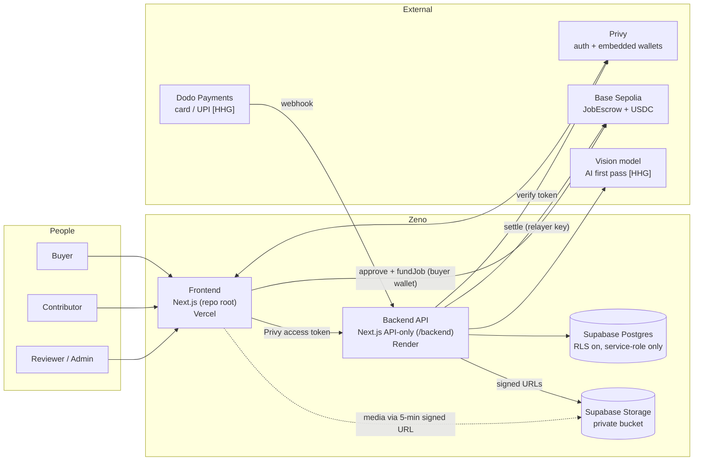
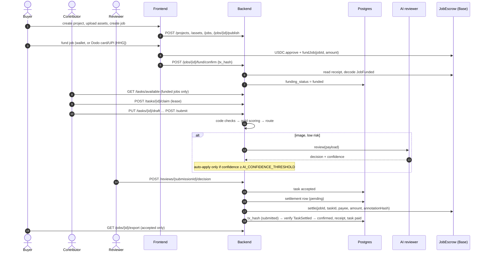

# Zeno — Architecture

Zeno is a verified data-labeling marketplace. Buyers upload private data and post
jobs; contributors label inside Zeno's workspace; code checks, gold tasks, an AI first
pass and human reviewers decide what is accepted; an on-chain escrow pays contributors
only for accepted labels, with a receipt per payout.

This document is the map. Details live in:

| Doc | Covers |
| --- | --- |
| [`docs/system/DATA-MODEL.md`](docs/system/DATA-MODEL.md) | Tables, state machines, invariants |
| [`docs/system/MONEY-FLOW.md`](docs/system/MONEY-FLOW.md) | Escrow contract, funding, settlement, receipts, USDC decimals |
| [`docs/system/QUALITY-PIPELINE.md`](docs/system/QUALITY-PIPELINE.md) | Code checks, gold, review routing, AI reviewer, appeals, reputation |
| [`docs/system/AUTH-AND-SECURITY.md`](docs/system/AUTH-AND-SECURITY.md) | Privy auth, roles, RLS, storage, keys, threat model |
| [`docs/PRD.md`](docs/PRD.md) | What we are building this week and why |
| [`docs/API-CONTRACT.md`](docs/API-CONTRACT.md) | HTTP API envelope and endpoints |

Status markers used throughout: **[live]** exists in the code today ·
**[HHG]** planned for the Hacker House Goa 2026 build (PRD F1–F6) ·
**[roadmap]** not this week.

---

## 1. System context

Two deployable apps, one database, one contract. The browser never holds a
secret: only the Privy access token and the public Privy app id.

## 2. Components

### 2.1 Frontend — repo root (`src/`) **[live]**

- Next.js 16 App Router. Route groups: `(marketing)`, `(auth)`, `(onboarding)`,
  `(product)/workspace/{buyer,contributor,reviewer,admin}`.
- `src/components/providers/Providers.tsx` — `PrivyProvider` (email + wallet login,
  embedded wallet for users without one, supported chains).
- `src/lib/api/platform.ts` / `live.ts` — token-bound API client with zod response
  schemas. All product data comes from the backend; nothing reads Supabase directly.
- Dev runs on `https://localhost:3000` (SIWE requires HTTPS) and proxies
  `/platform/*` → backend (`next.config.ts` rewrite) to stay same-origin.
- Editors: `AnnotationWorkspace.tsx` — native bounding-box (`image-boxes-v1`) and
  action-segment (`action-segments-v1`) editors. CVAT is not integrated
  (`docs/CVAT-INTEGRATION.md`).

### 2.2 Backend — `/backend` **[live]**

API-only Next.js app (`backend/app/api/**/route.ts`). Each route is thin:
`withCors(withErrorHandler(...))` → `requireRole(req, role)` → zod body validation →
a service in `backend/lib/**` → `ok(...)` envelope.

| Module (`backend/lib/`) | Responsibility |
| --- | --- |
| `auth/` | Privy token verification, user upsert, `requireRole` |
| `onboarding/` | Account-type choice, atomic buyer org creation (SQL RPC) |
| `jobs/` | Job CRUD, lifecycle (draft → published → paused → closed) |
| `tasks/` | Leases, drafts, submission, state machine, gold scoring, fast-submit guard |
| `annotation/` | Payload validation per schema |
| `review/` | Routing, AI reviewer, human queue, decisions |
| `appeals/` | Appeal filing and adjudication |
| `settlement/` | Mock + chain settlement, preflight, reconciliation, fixed-point money |
| `export/` | Accepted-only COCO / JSONL / CSV + provenance manifest |
| `validation/` | zod schemas for every request body |
| `idempotency.ts`, `rateLimit.ts`, `hash.ts`, `storage.ts` | Cross-cutting helpers |

**[live, F1]** `lib/settlement/network.ts` (chain from env, 6-decimal USDC units) and
`lib/settlement/funding.ts` (JobFunded verification).
**[live, F2]** `lib/funding/` (pricing, Dodo checkout + webhook, treasury funder, payment state
machine) and `app/api/payments/*`.
**[HHG]** planned: `lib/review/aiReviewer.ts` (real model), `lib/reputation/` (score + tier),
`app/api/demo/royalty` (F5).

### 2.3 Data — Supabase **[live]**

Postgres with migrations in `backend/supabase/migrations/` (001–010). RLS enabled on
every table and `anon`/`authenticated` hold **no** privileges; only the backend's
service role touches data. Media is in a private Storage bucket, served via signed URLs
with a 300 s TTL. See `DATA-MODEL.md`.

### 2.4 Contracts — `/contracts` (Foundry)

| Contract | Status | Purpose |
| --- | --- | --- |
| `JobEscrow.sol` | **[live]** ERC-20 USDC, ABI v3 (was native MON) | Per-job escrow; relayer-only settle; one payout per task; budget cap; close-before-withdraw |
| `RoyaltySplitter.sol` | **[live on Base Sepolia — P2 demo]** | Split one USDC payment 50 / 30 / 20 (Zeno / data owner / contributors) |

## 3. Core flow (the loop we demo)

## 4. Cross-cutting invariants

These hold across every layer and are tested at each one. Breaking one is a P0 bug.

1. **Only accepted work is paid.** A rejected task never reaches `paid`; appeals are the
   only route from `rejected` back to `accepted`.
2. **At most one payout per task.** DB: `settlements.task_id UNIQUE`; chain:
   `settled[keccak(jobId, taskId)]`.
3. **Payouts never exceed the funded budget.** Checked in the backend and enforced by the
   contract.
4. **A receipt is real only when proven.** `is_mock = false` only after a successful
   tx receipt *and* a decoded `TaskSettled` matching job, task, payee, amount and hash.
5. **No floating-point money.** Amounts are decimal strings (`NUMERIC(18,6)`), summed in
   micro-units (`settlement/money.ts`), and converted at the chain boundary with
   `parseUnits(amount, 6)` (`lib/settlement/network.ts`).
6. **Settlement fails closed.** Real settlement runs only when env is complete *and* the
   preflight passes; otherwise the mock is used and the UI labels it as mock.
7. **Buyer data stays private.** Contributors see only tasks they have leased, through
   short-lived signed URLs; exports and receipts contain no contributor identity.
8. **Roles are server-side.** The browser's role display is cosmetic; `requireRole` decides.

## 5. Deployment

| Piece | Where | Config |
| --- | --- | --- |
| Frontend | Vercel (`zeno-web-app.vercel.app`) | root `.env.example` |
| Backend | Render (`render.yaml`, region singapore) | `backend/.env.example` |
| Database + storage | Supabase | migrations 001–010 |
| Contracts | Base Sepolia (USDC escrow not yet deployed; Monad deployment is prior work) | `contracts/foundry.toml`, `script/*.s.sol` |

Environment for the chain **[HHG]**: `CHAIN_ID` (84532 Base Sepolia; 8453 Base gated),
`RPC_URL`, `JOB_ESCROW_ADDRESS`, `USDC_ADDRESS`, `SETTLEMENT_PRIVATE_KEY` (relayer),
`SETTLEMENT_FORBIDDEN_ADDRESS` (deny-list). Frontend: `NEXT_PUBLIC_CHAIN_ID`,
`NEXT_PUBLIC_WALLETCONNECT_PROJECT_ID`.

## 6. Key decisions

| # | Decision | Why |
| --- | --- | --- |
| D1 | Postgres is the source of truth for tasks and annotations; the chain holds only money rules | Labels are large and private; the chain only needs to guarantee payment rules |
| D2 | Backend is a separate API-only app using the service role | One trust boundary; browser has no DB access; RLS denies everything else |
| D3 | Owner and relayer are different keys, enforced in the contract constructor | A leaked server key cannot withdraw escrow or add relayers |
| D4 | Escrow holds contributor payouts only; the Zeno fee is collected outside escrow **[HHG]** | Keeps the on-chain budget = sum of payable rewards, so the budget cap means something |
| D5 | USDC on Base, 6 decimals end to end **[HHG]** | Stable unit for buyers and contributors; matches the existing `NUMERIC(18,6)` columns exactly |
| D6 | AI reviewer is advisory below a confidence threshold and never fails open | A wrong or missing model answer sends work to humans, not to payment |
| D7 | Native editors instead of CVAT for the MVP | Keeps data inside Zeno with no extra service to secure |
| D8 | One chain at a time, chosen by env | PRD non-goal: multi-chain; switching testnet ↔ mainnet is config, not code |

## 7. Prior work

Everything in this repository up to commit `cf77d5f` (2026-10-28) was built for an
earlier Monad hackathon. HHG 2026 work is the commits from 2026-10-28 onward, starting on
branch `hhg-base-usdc`. See the README "Prior work" section.
