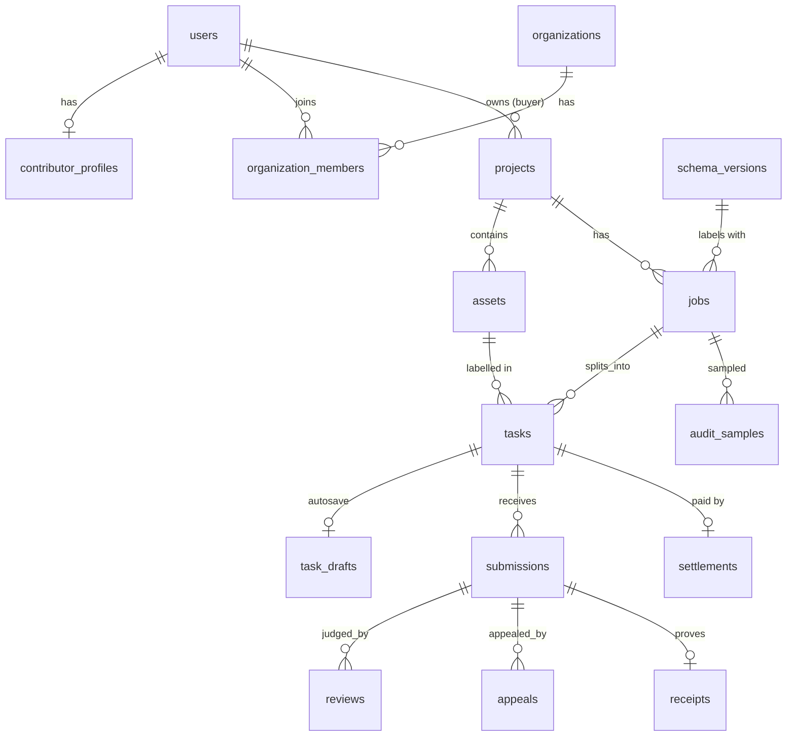
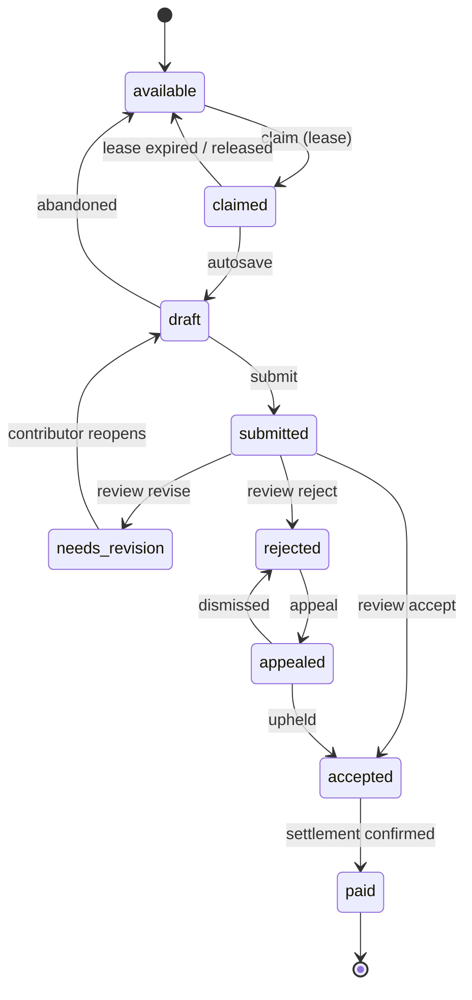
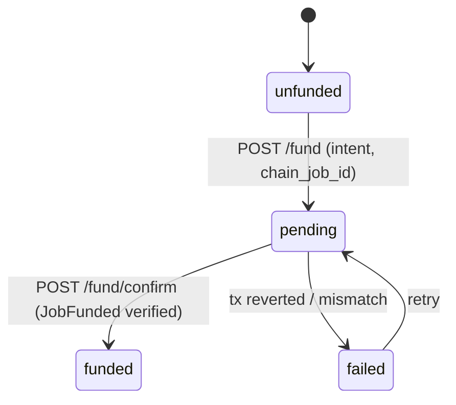
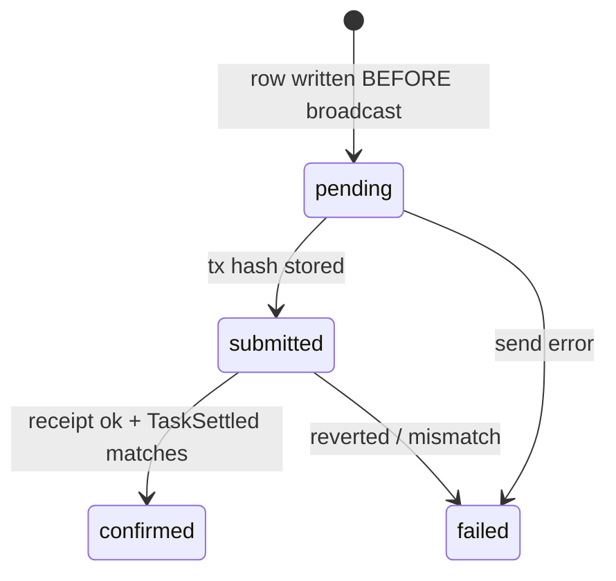

# Data model

Source of truth: `backend/supabase/migrations/001`–`010`. This page summarises; the SQL wins
if they disagree. All money columns are `NUMERIC(18,6)` — 6 decimals, which is exactly USDC's
on-chain precision **[HHG]**.

## 1. Entities

| Table | Key columns | Notes |
| --- | --- | --- |
| `users` | `privy_did` (unique), `wallet_address` (unique), `role`, `status` | Created on first Privy login; role chosen in onboarding |
| `contributor_profiles` | `qualification_passed`, `gold_accuracy`, `revision_rate`, `tasks_completed` | Feeds review routing; **[HHG]** adds `reputation_score`, `tier` |
| `organizations`, `organization_members` | `slug`, member `role` | Buyer orgs, created atomically by SQL RPC (migration 008) |
| `projects` | `buyer_id`, `data_rights`, `retention_policy` | Data rights declared before any job |
| `assets` | `object_key` (private storage), `content_hash`, dims/duration | Never public; served by signed URL |
| `schema_versions` | `schema_name`, `json_schema`, `label_list`, `version_hash` | `image-boxes-v1`, `action-segments-v1` |
| `jobs` | `reward_per_task`, `budget`, `status`, `policy_hash`, `rubric`, `chain_job_id`, funding fields | `chain_job_id = keccak256(utf8(job.id))` |
| `tasks` | `status`, `is_gold`, `gold_answer` (server-only), `lease_owner`, `lease_expiry` | `gold_answer` is never returned to contributors |
| `task_drafts` | `payload` | One autosave per task |
| `submissions` | `version`, `payload`, `payload_hash`, `schema_version`, `is_fast_flag`, `idempotency_key` | `payload_hash` = keccak of canonical JSON → `annotation_hash` on chain |
| `reviews` | `reviewer_type` (code/ai/human), `decision`, `reason_code`, `confidence`, `rubric_version` | AI suggestions are stored even when not auto-applied |
| `appeals` | `status`, `adjudicator_id` | One appeal per rejected submission |
| `settlements` | `task_id` **UNIQUE**, `status`, `tx_hash`, `is_mock`, `amount` | The payout ledger (migration 009) |
| `receipts` | `annotation_hash`, `policy_hash`, `review_ref`, `tx_hash`, `is_mock` | Public receipt page; no contributor identity |
| `idempotency_keys` | `key`, `endpoint`, `response` | Replays the stored response for retried writes |
| `audit_samples` | `selected_task_ids` | Random QA sampling (VRF field reserved, unused) |

**[HHG]** planned tables:

| Table | Purpose |
| --- | --- |
| `payments` | Dodo payment id (unique), job, amount paid, fee, status, webhook event ids — idempotent fiat funding |
| `royalty_demo_payouts` | One row per demo split call (F5) |

## 2. State machines

### 2.1 Task (`backend/lib/tasks/stateMachine.ts`)

`paid` is terminal. `rejected` is terminal unless appealed. Every transition goes through
`assertLegalTransition`.

### 2.2 Job lifecycle

`draft → published ⇄ paused → closed`. Publishing creates tasks. Tasks are visible to
contributors only when the job is `published` **and** `funding_status = 'funded'`.

### 2.3 Job funding (`jobs.funding_status`)

**[HHG]** F2.6 shows a buyer-facing `closed` label, derived from `jobs.status = 'closed'` plus
on-chain `closeJob`, not a new funding state.

### 2.4 Settlement (`settlements.status`)

Crash recovery (`/api/settlement/reconcile`) re-verifies `submitted` rows by tx hash; it never
re-broadcasts a row that already has a hash.

## 3. Money representation

| Layer | Form | Rule |
| --- | --- | --- |
| API / DB | decimal string, ≤ 12 integer digits, ≤ 6 decimals, > 0 | `normaliseMonAmount` (historical name; validates USDC) |
| Backend math | `bigint` micro-units | `settlement/money.ts` (`sumDecimalStrings`, `withinBudget`) |
| Chain | `uint256` base units | `toTokenUnits` = `parseUnits(amount, 6)`; `1 USDC = 1_000_000` |
| UI | `"1.5 USDC"` | `formatUsdc`; never shown as fiat |

`Number()` is never used on money.
