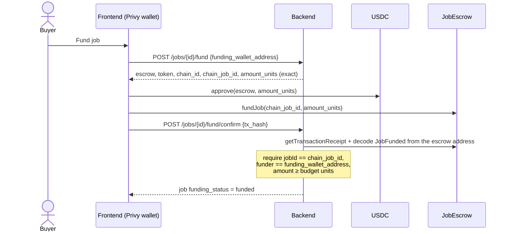
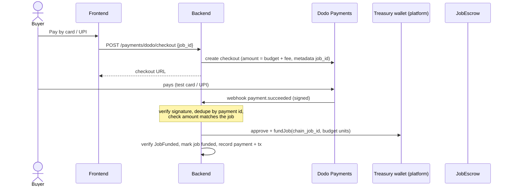

# Money flow — escrow, funding, settlement

> **Safety gate:** no real funds move (Base mainnet, real USDC, real Dodo money) until every
> open item in [`docs/AUDIT-2026-10.md`](../AUDIT-2026-10.md) is confirmed fixed and all keys
> are rotated. The key exposed during earlier development (audit F15) is compromised and is on
> the built-in deny-list (`COMPROMISED_SETTLEMENT_ADDRESSES`).

## 1. Chain and currency

| | Prior work (Monad build) | Now (HHG, F1 done) |
| --- | --- | --- |
| Chain | Monad testnet (10143) | Base Sepolia (84532) for dev and the demo; Base (8453) gated by the safety gate |
| Currency | native MON, 18 decimals | USDC (ERC-20), **6 decimals** |
| Chain config | hard-coded `monadTestnet` | `CHAIN_ID` + `RPC_URL` from env, mapped to viem `baseSepolia` / `base` in `lib/settlement/network.ts` |
| Token | — | `USDC_ADDRESS` env; Base Sepolia = Circle test USDC `0x036CbD53842c5426634e7929541eC2318f3dCF7e` (verify on Basescan before use) |

## 2. `JobEscrow` contract

### 2.1 Roles

| Role | Holder | Can |
| --- | --- | --- |
| owner | admin key, kept offline | set relayers, transfer ownership, `closeJob`, `withdraw` closed jobs |
| relayer | backend `SETTLEMENT_PRIVATE_KEY` | `settle` only |
| buyer | first caller of `fundJob` for a job | top up that job |

The constructor rejects owner == relayer. The owner is never a relayer by default.

### 2.2 Interface

```solidity
constructor(address owner, address relayer, IERC20 token);   // token immutable, non-zero
function token() external view returns (IERC20);
uint256 public constant SETTLEMENT_ABI_VERSION = 3;          // was 2 (native MON)

function fundJob(bytes32 jobId, uint256 amount) external;    // transferFrom(msg.sender, this, amount)
function settle(bytes32 jobId, bytes32 taskId, address payee, uint256 amount, bytes32 annotationHash)
    external;                                                // relayer only; transfer(payee, amount)
function closeJob(bytes32 jobId) external;                   // owner only
function withdraw(bytes32 jobId, address to) external;       // owner only, job must be closed

event JobFunded(bytes32 indexed jobId, address indexed funder, uint256 amount);
event TaskSettled(bytes32 indexed jobId, bytes32 indexed taskId, address indexed payee,
                  uint256 amount, bytes32 annotationHash);
```

### 2.3 Rules (each has a Foundry test)

1. Only relayers settle.
2. `settled[keccak256(abi.encodePacked(jobId, taskId))]` — once per task.
3. `paid + amount <= budget` for every job.
4. The first funder is the buyer; any other address topping up reverts `NotBuyer`.
5. No funding after close; no withdrawal while open.
6. Effects before interactions; `nonReentrant` on `settle` and `withdraw`.
7. Token calls check return data (a token returning `false` reverts); `fundJob`
   credits `amount` only after `transferFrom` succeeds.
8. Zero amounts and zero addresses revert.

### 2.4 Identifiers

`jobId = keccak256(utf8(job uuid))`, `taskId = keccak256(utf8(task uuid))`,
`annotationHash = submissions.payload_hash`. Same helpers on both sides
(`toBytes32Id`, `toTaskKey` in `backend/lib/settlement/chain.ts`).

## 3. Pricing and what goes into escrow

PRD assumption: buyer pays **$0.05** per accepted box, contributor receives **$0.04**.
Zeno's commission is **20 % of the buyer price**, which is **25 % on top of the reward**.

```
reward_per_task      = 0.04 USDC          (what escrow pays per accepted task)
escrow budget        = tasks × reward     (only this goes into JobEscrow)
zeno fee             = budget × 0.25      (collected outside escrow)
buyer total          = budget + fee       (shown in the wizard, F2.1)
```

The escrow holds contributor payouts only (decision D4). The fee is not in escrow: with
Dodo it stays with the platform (`ZENO_FEE_BPS`, default 2000, in `lib/funding/pricing.ts`).
**[live, open decision]** Direct wallet funding currently deposits the escrow budget only and
charges no fee; collecting it would add a USDC transfer to the treasury.

## 4. Funding paths

### 4.1 Direct wallet (crypto-native buyer) — F2.4



### 4.2 Card / UPI via Dodo Payments (test mode) — F2.2, F2.3 **[live]**



The treasury holds a USDC float; it is a **third key** (`TREASURY_PRIVATE_KEY`), separate from
owner and relayer (refused if it equals the relayer, is the escrow owner, or is on the deny-list),
server-side only, holding only test USDC this week. The treasury becomes the job's on-chain
`buyer`; the real buyer is recorded off-chain in `job_payments` (migration 011).

Code: `lib/funding/{dodo,pricing,treasury,service}.ts`; routes `GET /api/jobs/{id}/funding`,
`POST /api/jobs/{id}/fund/checkout`, `POST /api/payments/dodo/webhook`,
`POST /api/payments/{id}/fund` (admin retry). Payment states: `created → paid → funding →
funded`; without a treasury a paid job waits as **paid, awaiting funding** (job stays
`pending`). A broadcast funding tx is re-verified on retry, never re-sent, and the treasury never
funds a job that is pending through the buyer's own wallet.

## 5. Settlement (payout)

Code: `backend/lib/settlement/service.ts`, `chain.ts`, `repository.ts`.

1. Task must be `accepted`, with an accepting review, and its job funded.
2. Insert `settlements` row (`pending`) — `task_id` is UNIQUE, so a second attempt conflicts.
3. `withinBudget` check against the job budget and already-paid tasks.
4. Send `settle(...)` with the relayer key; store `tx_hash` → `submitted` **before** waiting.
5. Wait for the receipt. Require `status = success` and a decoded `TaskSettled` from the escrow
   address matching job, task, payee, amount (`parseUnits(reward, 6)`) and annotation hash.
6. Write the receipt (`is_mock = false`), mark settlement `confirmed`, task `accepted → paid`.
7. On any mismatch: `failed`, no receipt, task stays `accepted`.

Recovery: `POST /api/settlement/reconcile` re-verifies `submitted` rows by hash.

### 5.1 Service selection and preflight

Real settlement is used only when `JOB_ESCROW_ADDRESS`, `RPC_URL`, `SETTLEMENT_PRIVATE_KEY`
(plus `USDC_ADDRESS` and an allowed `CHAIN_ID`) are set **and** `runSettlementPreflight` passes:

| Check | Fails when |
| --- | --- |
| `configured` | any setting missing |
| `signer` | key is invalid |
| `chain_allowed` | `CHAIN_ID` not in the allow-list (84532 only this week) |
| `chain` | RPC chain id ≠ `CHAIN_ID` |
| `escrow_code` | no bytecode at the escrow address |
| `owner` / auth model | signer is owner, or signer is not a relayer |
| `escrow_abi_version` | ≠ 3 (rejects the old MON escrow) |
| `token` / `token_decimals` | `escrow.token() ≠ USDC_ADDRESS`, or `decimals() ≠ 6` |
| `forbidden` | signer or owner is in the deny-list, or the deny-list is empty |

Otherwise `MockSettlementService` is used: deterministic mock hash, `is_mock = true`, labelled
"mock" in the UI.

## 6. Royalty split demo — F5 **[live on Base Sepolia]**

`RoyaltySplitter.sol`: immutable token and three recipients with basis points summing to
10 000 (default 5000 / 3000 / 2000). `pay(amount)` pulls USDC from the caller and transfers each
share; rounding remainder goes to the Zeno share. The split is
custody-free (each share moves straight from the payer with `transferFrom`) and each `saleId` pays once.
`POST /api/demo/royalty` (admin) builds the split from real data — data owner = the job's buyer wallet,
contributors = wallets behind its accepted labels, weighted by count — and either previews it
(`dry_run`, or whenever `ROYALTY_SPLITTER_ADDRESS` is unset) or pays it from the treasury and verifies
the `SplitPaid` event. Shown on the admin page as **"Roadmap demo"**. Deploy with
`script/DeployRoyaltySplitter.s.sol`; deployed at `0x5E625CA857b293E315d95846D13485785D233A66`.

## 7. Decimal safety checklist (PRD risk #1)

- [x] Contract tests use 6-decimal amounts (`250_000` = 0.25 USDC), never `ether`.
- [x] No `parseEther` / `formatEther` left in backend or frontend (CI grep still to add).
- [x] Fund route returns `amount_units` from `parseUnits(budget, 6)`, not `Number × 1e18`.
- [x] Settlement match compares `parseUnits(reward, 6)` to the event amount.
- [x] UI formats with `formatUsdc` and never with fiat symbols.
- [ ] e2e: fund 1 USDC, settle 0.04 USDC, assert contributor balance delta = 40 000 units.
