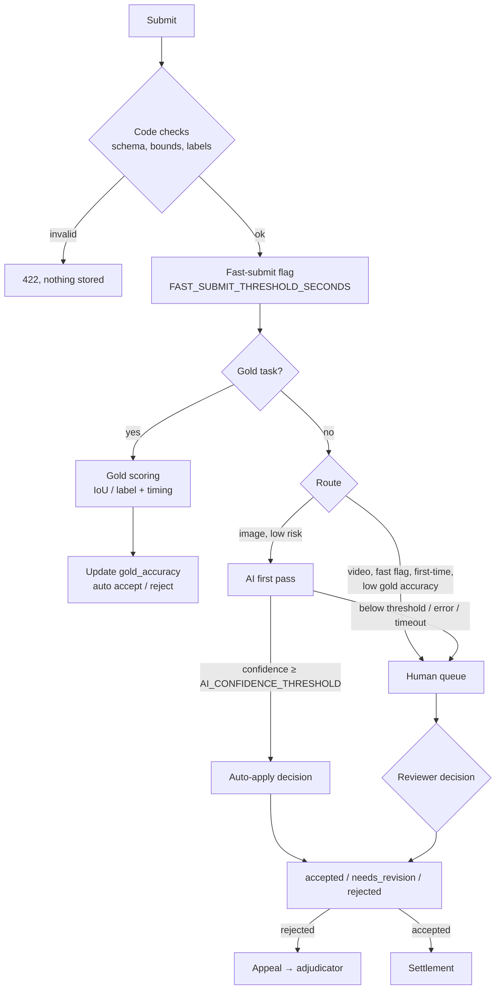

# Quality pipeline — from submission to accepted label

Every submission passes through the same ordered gates. A gate can only make the outcome
*more* cautious: anything uncertain ends in the human queue, never in an automatic payout.



## 1. Code checks **[live]**

`backend/lib/annotation/validate.ts` + `validation/payloads.ts`: payload matches the job's
schema version; labels in the job's `label_list`; boxes inside image bounds; segments ordered,
non-overlapping and within video duration. Failure is a 422; no submission row is written.

## 2. Gold tasks **[live]**

`backend/lib/tasks/goldScoring.ts`. A share of tasks are gold, with a hidden
`gold_answer` that never leaves the server.

| Schema | Pass rule |
| --- | --- |
| `image-boxes-v1` | each gold box matched by a same-label box with IoU ≥ `GOLD_IOU_THRESHOLD` (0.5) |
| `action-segments-v1` | same label and start/end within `GOLD_SEGMENT_MS_TOLERANCE` (500 ms) |

Gold results update `contributor_profiles.gold_accuracy` (rolling %).

## 3. Routing **[live]**

`backend/lib/review/router.ts` — pure function. Human lane when any of: video; fast-submit
flag; fewer than 5 completed tasks; gold accuracy below 80 %. Otherwise AI lane.

## 4. AI first pass

**[live]** `MockAiReviewer` — deterministic heuristics, `rubric_version = "mock-v1"`.

**[live, F3]** `ClaudeAiReviewer` (`lib/review/claudeAiReviewer.ts`) — Claude Sonnet 5.5
(`claude-sonnet-5-5`, effort `medium` by default) behind the same contract, selected by
`lib/review/aiReviewer.ts` only when `ANTHROPIC_API_KEY` is set and `AI_REVIEWER` is not `mock`.
The model call runs **after** the submit response (`next/server` `after`), with a 45 s timeout;
the auto-applied status change is conditional on the task still being `submitted`, so a human
who decides first always wins. Rubric version: `zeno-image-review-v1:<model>`.

```ts
interface AiReviewer {
  review(input: AiReviewInput): Promise<AiReviewResult>;   // becomes async
}
interface AiReviewResult {
  decision: "accept" | "revise" | "reject";
  reason_code: ReasonCode;          // from the existing enum only
  confidence: number;               // 0–1
  notes: string;
  rubric_version: string;           // e.g. "vision-v1:<model id>"
}
```

Design rules:

- **Input:** the asset via a short-lived signed URL (never made public), the job's label list
  and rubric, and the submitted boxes. Images only (F3.5).
- **Output:** strict JSON validated with zod. Anything unparseable, any reason code outside the
  enum, or a confidence outside 0–1 is treated as an error.
- **Fail safe (F3.4):** timeout, error or invalid output → no AI decision applied; the submission
  stays `submitted` in the human queue, and the failure is recorded in review notes.
- **Threshold (F3.3):** auto-apply only when `confidence ≥ AI_CONFIDENCE_THRESHOLD` (0.75).
  Lower-confidence suggestions are stored as a `reviews` row with `reviewer_type = 'ai'` and
  shown to the human reviewer.
- **Config:** provider key server-side only; `AI_REVIEWER=mock|model` selects the
  implementation, so tests and keyless environments keep the mock.
- **Model choice:** Claude Sonnet 5.5 (PRD §9 Q4 decided 2026-10-29). Rough cost
  ≈ $0.005–0.01 per reviewed image at `medium` effort (est.).
- **Privacy:** the image is downloaded server-side through a 60 s signed URL and sent to
  Anthropic's API as base64; the signed URL itself never leaves the backend. Images over 5 MB or
  of unsupported types go to a human.

The interface change from sync to async touches `review/service.ts` (`applyAutoRouting`) and
its tests; nothing else calls the reviewer.

## 5. Human review and appeals **[live]**

- Queue: `GET /api/review/queue` — tasks in `submitted`, with any AI suggestion attached.
- Decision: `POST /api/reviews/{submissionId}/decision` with a reason code from
  `ReviewConsole.tsx`'s list. Reviewers cannot review their own work.
- Appeals: contributor files once per rejected submission; a reviewer (never the submitting
  contributor) upholds (→ `accepted`, payable) or dismisses (→ `rejected`, final). The code does
  not yet require the adjudicator to differ from the original reviewer — candidate hardening.

## 6. Contributor reputation — F4 **[live]**

New module `backend/lib/reputation/`, pure scoring + one repository function.

```
score = w_gold × gold_accuracy + w_accept × acceptance_rate      (0–100)
acceptance_rate = accepted / (accepted + rejected + needs_revision), over the last N decisions
```

| Tier | Requirement (defaults; all configurable via env) | Can claim |
| --- | --- | --- |
| New | signed up | practice + gold tasks only (unpaid) |
| Verified | ≥ 5 gold tasks, gold accuracy ≥ 80 % | paid image tasks |
| Trusted | Verified + ≥ 50 accepted, score ≥ 85 | + video tasks |
| Reviewer | Trusted + admin promotion | review queue (role change stays an admin action) |

- Computed on demand from existing data (`lib/reputation/service.ts`): gold passes/fails from
  `code` reviews on gold submissions, outcomes from each non-gold task's current status. Cached on
  `contributor_profiles` (`reputation_score`, `tier`; migration 012). Thresholds are env-configurable
  (`REPUTATION_*`); `REPUTATION_GATING=off` disables gating.
- **No one loses existing access:** migration 012 gives every contributor that exists at migration time
  a `tier_floor` of `trusted` (a floor lifts the tier, never lowers it). If the migration is not yet
  applied, gating switches itself off rather than demoting everyone.
- Enforced in `GET /tasks/available` and `POST /tasks/{id}/claim` (server-side, not just hidden
  in the UI).
- Shown on the contributor earnings page (F4.4).
- The Reviewer tier makes someone *eligible*; promotion to the `reviewer` role remains a manual
  admin action, so reputation can never self-escalate privileges.

## 7. Duplicate-account detection — F6.2 **[live; TigerGraph engine ready]**

TigerGraph graph of users ↔ wallets ↔ devices ↔ submission hashes; accounts sharing a wallet
or producing near-identical payloads are flagged for admin review. Flags route to humans only;
they never auto-reject or block payouts on their own.
